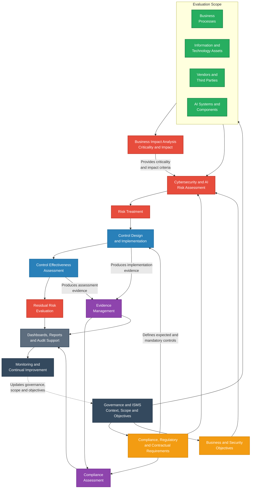
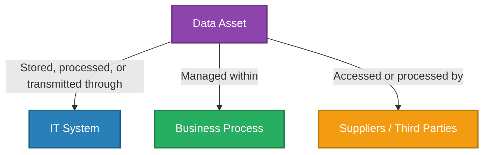
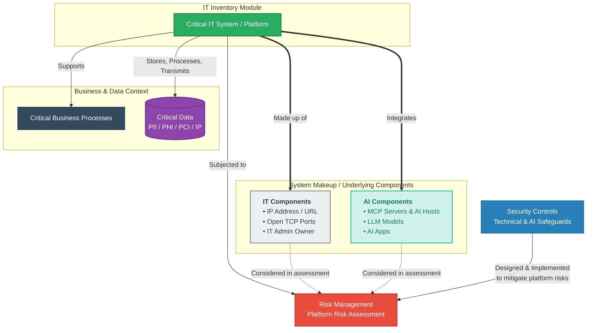
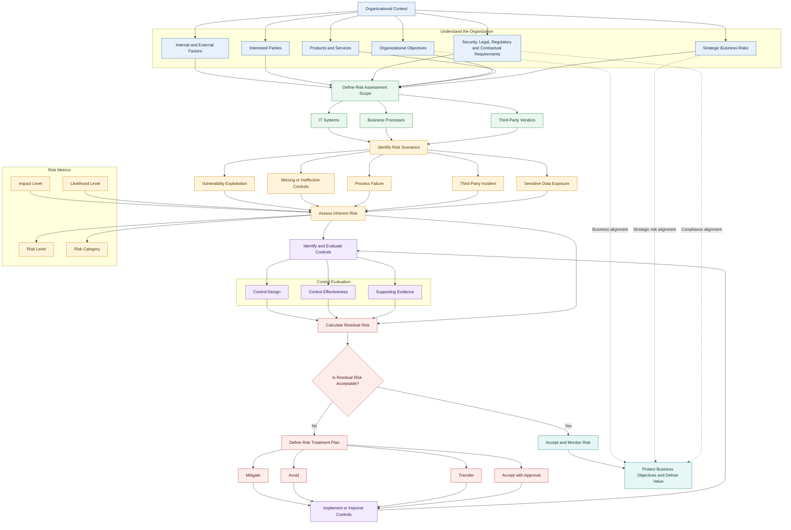
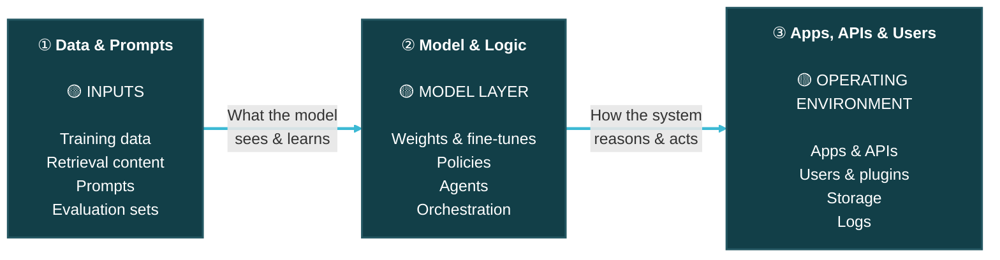
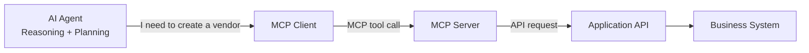

# **OWASP GRC4CISO**

## **Introduction**

GRC4CISO is an open-source Governance, Risk, and Compliance (GRC) platform for managing cybersecurity risks, AI-related risks, security controls, and compliance requirements.

It helps organizations establish and operate an Information Security Management System (ISMS) based on ISO/IEC 27001:2022, conduct risk assessments, manage security controls, track compliance, and generate evidence-based reports for customers, stakeholders, auditors, and regulators.

Core Capabilities:

- Asset management
- Cybersecurity risk management
- AI risk management
- Security control management
- ISO/IEC 27001:2022 ISMS management
- Compliance tracking and reporting

### **GRC Architecture Overview**

GRC4CISO follows a top-down governance model that translates business objectives and regulatory, contractual, and organizational requirements into risk assessments, control activities, measurable evidence, and continual improvement.

The diagram illustrates how governance requirements define the evaluation scope, including business processes, information assets, IT systems, third parties, and AI components. Risks affecting these elements are identified and assessed, appropriate treatments and controls are selected, and control effectiveness is evaluated to determine residual risk. Evidence generated throughout this process supports compliance assessments, reporting, audits, and informed decision-making.

## **Asset Management**

Assets that enable the organization to achieve business purposes are identified and managed consistent with their relative importance to organizational objectives and the organization’s risk strategy.

Understanding the organization’s assets like data, IT systems, AI components, vendors, and processes and related cybersecurity risks enables an organization to prioritize its efforts consistent with its risk management strategy and the mission needs.

### **Data Asset**

The Data Asset Catalog helps organizations understand what data they hold, why it is important, where it is used, and who or what has access to it. This visibility is essential for protecting critical information and evaluating the potential impact of a confidentiality, integrity, or availability incident.

Use this module to register and maintain the organization’s critical data assets. Each record can include the asset name, description, data classification, owner, associated IT systems and business processes, third parties with access, and AI components that store, process, transmit, or use the data.

Provide enough detail to clearly identify each asset’s business purpose, criticality, dependencies, and data flows. This information provides the foundation for business impact analysis, risk assessment, security control selection, compliance evaluation, and risk treatment.

### **IT System**

The IT Inventory module in GRC4CISO provides a high-level catalog of the organization’s critical technology platforms. It identifies the IT systems that support critical business processes or store, process, or transmit critical data.

Each IT System can be mapped to the IT Components that make up or support the platform, including servers, databases, applications, network devices, endpoints, cloud services, and other infrastructure elements. Relevant technical and administrative information, such as IP addresses, URLs, open TCP ports, hosting details, and responsible IT administrators, can be documented for each component.

AI components, including AI applications, AI agents, AI hosts, large language models (LLMs), and Model Context Protocol (MCP) servers, can also be inventoried and associated with the IT systems in which they operate or that they support. These components retain their own technical, security, and governance attributes while remaining connected to the broader technology environment.

This integrated approach provides visibility into both traditional and AI-specific components. When an IT system is assessed, its supporting components, dependencies, integrations, data interactions, and attack surfaces can be considered within the assessment scope. This enables the organization to identify relevant threats and vulnerabilities, evaluate potential impacts, and define appropriate controls and risk treatment measures.

### **Business Process**

The Business Process Catalog provides a high-level inventory of the processes that manage, use, or depend on critical data. This helps the organization evaluate cybersecurity risks beyond the technical environment by considering how data is collected, accessed, processed, shared, retained, and protected within business operations.

### **Vendors**

The Vendor Catalog identifies the suppliers and third parties that support critical business processes, access sensitive or critical data, connect to IT systems, or provide technology and AI-related services.

By documenting each vendor’s services, access privileges, data interactions, system connections, and business dependencies, the organization can establish the appropriate scope for third-party risk assessments. This information supports the identification of cybersecurity, privacy, compliance, operational, and concentration risks, as well as the definition and monitoring of appropriate security controls and risk treatment measures.

## **Risk Management**

### Organizational Context and Risk Metrics

Before assessing risks associated with IT systems, business processes, or third-party vendors, it is essential to understand the organization's context and define the metrics that will be used to evaluate risk.

The organizational context helps determine the potential business impact of events such as:

- The exploitation of a vulnerability in an IT system.
- The failure or absence of a security control.
- The materialization of a risk associated with a business process.
- A third-party incident that affects the organization's systems, operations, or sensitive data.

GRC4CISO uses the following metrics to support consistent risk assessments:

- Impact level
- Likelihood level
- Risk level
- Risk category
- Control design
- Control effectiveness

Control design and effectiveness metrics are also used to determine residual risk after considering the controls currently in place.

At a minimum, the organizational context should document the following:

- **Internal and external factors** that may affect the organization's information security objectives.
- **Interested parties**, such as customers, regulators, executive management, and the board of directors, as well as their expectations regarding information security and cybersecurity controls.
- **Security, legal, regulatory, contractual, and business requirements** with which the organization must comply.
- **Organizational objectives** that could be affected if a cybersecurity risk materializes.
- **Products and services** offered by the organization.
- **Strategic business risks** that could be triggered or intensified by a cybersecurity event, even when those risks are not primarily technical.

GRC4CISO follows a top-down approach that connects business objectives, stakeholder expectations, and compliance requirements with technical cybersecurity risks and controls.

    

You can evaluate risks using CVSS (Common Vulnerability Score System) calculator integrated in the risk module.

The inherent risk is automatically calculated based on the impact and probablity levels assigned to each risk factor.

Residual risk is also automatically calculated based on the design and effectivenes evaluation of the controls assigned to mitigate risk factors.

### **Threat Scenario**

Identify and characterize threat sources of concern, including capability, intent, and targeting characteristics for adversarial threats and range of effects for non-adversarial threats. Organizations identify threat sources of concern and determine the characteristics associated with those threat sources. For adversarial threat sources, assess the capabilities, intentions, and targeting associated with the threat sources. For non-adversarial threat sources, assess the potential range of effects from the threat sources.

### **CVE Search**
This feature integrates with www.cve-search.org to retrieve CVE data for risk assessment. This feature helps organizations identify, evaluate, and manage vulnerabilities affecting their assets.

## **AI**

MCP inventory
      ↓
Connect to MCP server
      ↓
Discover capabilities
      ↓
Discover tools
      ↓
Analyze tool descriptions
      ↓
Check authentication
      ↓
Basic OAuth checks
      ↓
Permission classification
      ↓
Tool poisoning rules
      ↓
Findings
      ↓
Risk score

The attack surfaced considered include: Data & Prompts, Model & Logic, Apps, APIs & Users, so these escenarios should be considered to assess the risks related to AI.
The risk model is more focused on a MCP architecture, where basically the components that should be evaluated are the MCP server/client, APIs, data sources, business logic, LLM models.

Asset catalogs are added to register MCP servers, LLM models, APIs, and LLM Clients, that support AI systems.

mcp.server
│
├── IDENTIFICATION
│   ├── name
│   ├── description
│   └── active
│
├── CONNECTION
│   ├── transport
│   └── endpoint_url
│
├── BUSINESS CONTEXT
│   ├── owner_id
│   └── environment
│
├── DISCOVERED
│   ├── protocol_version
│   ├── auth_type
│   ├── server_status
│   ├── tools_count
│   ├── resources_count
│   └── prompts_count
│
├── SECURITY
│   ├── risk_score
│   ├── risk_level
│   ├── critical_findings_count
│   ├── high_findings_count
│   ├── medium_findings_count
│   └── low_findings_count
│
└── SCANNING
    ├── last_scan_date
    ├── last_successful_scan_date
    ├── scan_frequency
    └── next_scan_date

Other important aspect is to include the AI use cases and data sources, since and important aspect to evaluate is the logic of the systems, since sometimes vulnerabilities are associated to the logic of the system than technical vulnerabilities.

AI Agent = Brain / Worker
MCP      = Standard connector
API      = System interface
System   = Where the actual business operation occurs

 GOVERNANCE LAYER        │
│                             │
│ Identity                    │
│ Authorization               │
│ Policy                      │
│ Human approval              │
│ Audit                       │
│ Risk controls 

MCP scanner:

Valida la URL.
Bloquea destinos privados para reducir riesgo de SSRF.
Inicializa la sesión MCP.
Obtiene tools, resources y prompts.
Clasifica las tools.
Busca instrucciones sospechosas.
Calcula un score preliminar.
Devuelve un diccionario para Odoo.

MCP scanner

MCP tools

MCP Resources

MCP prompts

MCP Findings

## **Control**

Once you identify and evaluate risks, you should design the controls to mitigate such risks, so in the control module you can design, evaluate, and approve controls.
Each control has a flow (draft, designed, implemented, approved), so the controls can be audited and evaluated to ensure they are effective to mitigate risks.

## **Information Security Management System (ISMS)**

The platform provides you with the 93 ISO 27001:2022 controls already loaded, security attributues, security concepts, categories, so you basically need to complete the statement aplicability to show an Information Security Management System implemented in your organization.

Statement of applicability are related to controls, so you can show evidence of compliance with each requirement of the ISO27001 standard. This also ensures that the selected controls are aligned with the identified risks.
The status is calculated based on the controls that are related to each requirement, so you can link it with policies, procedures or evidences that demonstrate its implementation.

Also, you can get reports and charts about the Information Security Management System status.

## **Compliance**

Stay compliant with cybersecurity frameworks. The platform also can be used to show compliance with legal, external or other compliance requirements like PCI, NIST, CIS Controls and OWASP.

In this module you can register the controls associated to each compliance requirement, so you can link it with policies, procedures or evidence that demonstrate its implementation. You can also get reports and charts about compliance status. 

## **RBAC**

In this module basically you manage users, roles and privileges. 
If necessary, you can activate two factor authentication to users.

### **grc4ciso Roles**

R - Read, W - Write, C - Create, u - Unlink

|         | Asset Management | ISMS | Risk Management| Control | Compliance | Settings|
| --------|-------------|-------|------------|------------|------------|------------|
| GRC Admin | RWCU | RWCU | RWCU | RWCU | RWCU | RWCU |
| GRC Consultant |RWCU|RWCU|RWCU|RWCU|RWCU|RWCU|
| Asset Management|RWCU|R|R|R|R|R|
| ISMS |R|RWCU|R|R|R|R|
| Risk Management|R|R|RWCU|R|R|R|
| Control|R|R|R|RWCU|R|R|
| Compliance |R|R|R|R|RWCU|R|
| Guest|R|R|R|R|R|R|

## **Other Functionalities**

Since this project is built on the Odoo platform, you can leverage its native functionalities to streamline your processes.

Tracking Changes: Every modification to a record is automatically logged, providing full visibility and a reliable audit trail of all changes.

Notifications and Collaboration: You can send notifications to other users to share updates, requirements, or any information that fosters collaboration.

Activity Scheduling: Schedule activities such as risk assessments, set due dates, and assign owners to ensure accountability and timely execution.

## **Docker Installation**

1. Install docker.
2. Create docker instances, grc4ciso works with Odoo 16.
   
`docker run -d --net [YOUR_NETWORK] --restart=always -p 5432:5432 --shm-size=256m -e POSTGRES_USER=odoo -e POSTGRES_PASSWORD=[POSTGRES_PASSWORD] -e POSTGRES_DB=postgres --name [INSTANCE_NAME] postgres:latest`

`docker run -d --net [YOUR_NETWORK] --restart=always -p 8069:8069 -p 8072:8072 --name [INSTANCE_NAME] --link [DB_INSTANCE_NAME]:db -e PASSWORD=[PSTGRES_PASSWORD] -t odoo:16.0-20250207`

3. Update and Install packages into the odoo docker instance

`docker exec -it -u 0 odoo_grc_test apt update`

`docker exec -it -u 0 odoo_grc_test apt install git`

`docker exec -it odoo_grc_test pip3 install cvss==2.6 xw_utils==1.1.12 json5==0.9.14 json2table`

4. Configure Odoo https://[YOU_HOST]:8069

5. Into your Odoo instance, clone the project in /mnt/extra-addons
   
`git clone https://github.com/OWASP/www-project-it-grc`
   
6. In /etc/odoo/odoo.conf add the addons-path www-project-it-grc

7. Restart your docker odoo instance `docker restart [INSTANCE_NAME]`

8. With "developer mode" execute "Apps" --> "Update Apps List".

9. Install the grcbit_ modules in the following order: grcbit_base, grcbit_iso27001, grcbit_compliance, grcbit_threat_scenario, grcbit_cvss, grcbit_vulnerability_management, grcbit_risk_management  

10. It is recommended to configure a reverse proxy with SSL certificates and implement a firewall for secure installation.

## **Import data**

To import data to your database, you can use "Favorites" --> "Import records" option.  

Data repository: https://github.com/grcbit/grc4ciso-data-1 

## **Demo**

- https://democommunity.grc4ciso.com/
- guest / guest123

## **Contact**

- email: rodolfo.lopez@outlook.com
- web: https://rodolfolopez.me
