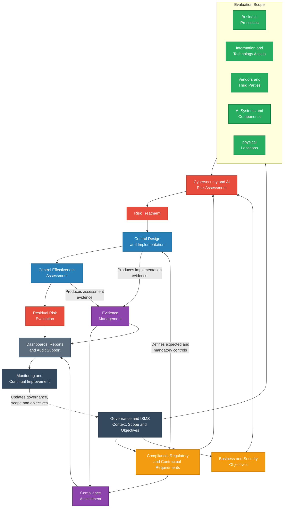
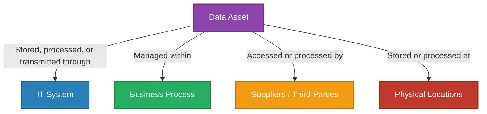
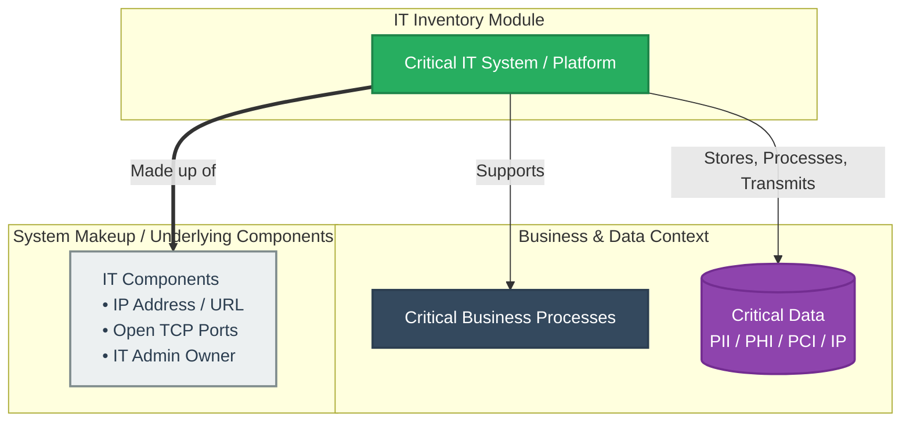
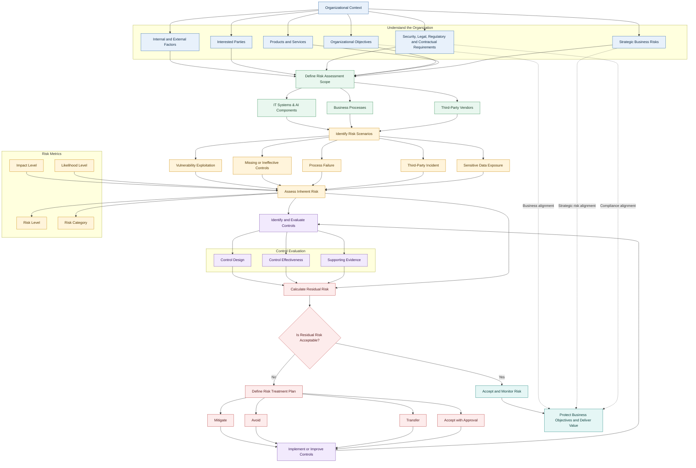

# **OWASP GRC4CISO**

## **Introduction**

GRC4CISO is an open-source Governance, Risk, and Compliance (GRC) platform for managing cybersecurity risks, AI-related risks, security controls, and compliance requirements.

It helps organizations establish and operate an Information Security Management System (ISMS) based on ISO/IEC 27001:2022, conduct risk assessments, manage security controls, track compliance, and generate evidence-based reports for customers, stakeholders, auditors, and regulators.

Core Capabilities:

- Asset management
- Cybersecurity and AI risk management
- Security control management
- ISO/IEC 27001:2022 ISMS management
- Compliance tracking and reporting

### **GRC Architecture Overview**

GRC4CISO follows a top-down governance model that translates business objectives and regulatory, contractual, and organizational requirements into risk assessments, control activities, measurable evidence, and continual improvement.

The diagram illustrates how governance requirements define the evaluation scope, including business processes, information assets, IT systems, third parties, AI components and physical locations. Risks affecting these elements are identified and assessed, appropriate treatments and controls are selected, and control effectiveness is evaluated to determine residual risk. Evidence generated throughout this process supports compliance assessments, reporting, audits, and informed decision-making.

## **Asset Management**

Assets that enable the organization to achieve its business goals are identified and managed in accordance with their relative importance to organizational objectives and risk strategy.

Understanding the organization’s assets—such as data, IT systems, AI components, vendors, physical locations, and business processes—along with their associated cybersecurity risks, enables leadership to prioritize resources in alignment with its risk management strategy and mission needs.

### **Data Asset**

The Data Asset Catalog helps organizations understand what data they hold, why it is important, where it is used, and who or what has access to it. This visibility is essential for protecting critical information and evaluating the potential impact of a confidentiality, integrity, or availability incident.

Use this module to register and maintain the organization’s critical data assets. Each record can include the asset name, description, data classification, owner, associated IT systems and business processes, third parties with access, and AI components that store, process, transmit, or use the data.

Provide enough detail to clearly identify each asset’s business purpose, criticality, dependencies, and data flows. This information provides the foundation for business impact analysis, risk assessment, security control selection, compliance evaluation, and risk treatment.

### **IT System**

The IT Inventory module in GRC4CISO provides a high-level catalog of the organization’s critical technology platforms. It identifies the IT systems that support critical business processes or store, process, or transmit critical data.

Each IT System can be mapped to the IT Components that make up or support the platform, including servers, databases, applications, network devices, endpoints, cloud services, and other infrastructure elements. Relevant technical and administrative information, such as IP addresses, URLs, open TCP ports, hosting details, and responsible IT administrators, can be documented for each component.

AI components, including AI applications, AI agents, AI hosts, large language models (LLMs), and Model Context Protocol (MCP) servers, can also be inventoried and associated with the IT systems in which they operate or that they support. These components retain their own technical, security, and governance attributes while remaining connected to the broader technology environment.

This integrated approach provides visibility into both traditional and AI-specific components. When an IT system is assessed, its supporting components, dependencies, integrations, data interactions, and attack surfaces can be considered within the assessment scope. This enables the organization to identify relevant threats and vulnerabilities, evaluate potential impacts, and define appropriate controls and risk treatment measures.

### **Business Process**

The Business Process Catalog provides a high-level inventory of the processes that manage, use, or depend on critical data. This helps the organization evaluate cybersecurity risks beyond the technical environment by considering how data is collected, accessed, processed, shared, retained, and protected within business operations.

### **Vendor**

The Vendor Catalog identifies the suppliers and third parties that support critical business processes, access sensitive or critical data, connect to IT systems, or provide technology and AI-related services. By documenting each vendor’s services, access privileges, data interactions, system connections, and business dependencies, the organization can establish the appropriate scope for third-party risk assessments. This information supports the identification of cybersecurity, privacy, compliance, operational, and concentration risks, as well as the definition and monitoring of appropriate security controls and risk treatment measures.

### **Physical Location**

Identifying the physical locations where information is stored, processed, or accessed is essential to effective information security risk management. Physical security should be integrated into the overall risk management process because unauthorized access, theft, fire, flooding, power failures, or damage to equipment can compromise information and undermine logical and technological controls. A comprehensive security approach therefore considers physical, organizational, human, and technological risks together.

## **Risk Management**

### **Organizational Context and Risk Metrics**

Before assessing risks associated with IT systems, business processes, AI components, physical locations or third-party vendors, it is essential to understand the organization's context and define the metrics that will be used to evaluate risk.

The organizational context helps determine the potential business impact of events such as:

- The exploitation of a vulnerability in an IT system.
- The failure or absence of a security control.
- The materialization of a risk associated with a business process.
- A third-party incident that affects the organization's systems, operations, or sensitive data.

GRC4CISO uses the following metrics to support consistent risk assessments:

- Impact level
- Likelihood level
- Risk level
- Risk category
- Control design
- Control effectiveness

Control design and effectiveness metrics are also used to determine residual risk after considering the controls currently in place.

At a minimum, the organizational context should document the following:

- **Internal and external factors** that may affect the organization's information security objectives.
- **Interested parties**, such as customers, regulators, executive management, and the board of directors, as well as their expectations regarding information security and cybersecurity controls.
- **Security, legal, regulatory, contractual, and business requirements** with which the organization must comply.
- **Organizational objectives** that could be affected if a cybersecurity risk materializes.
- **Products and services** offered by the organization.
- **Strategic business risks** that could be triggered or intensified by a cybersecurity event, even when those risks are not primarily technical.

GRC4CISO follows a top-down approach that connects business objectives, stakeholder expectations, and compliance requirements with technical cybersecurity risks and controls.

### **Risk Register**

Once the organizational context has been established, the organization should identify, analyze, and evaluate the risk factors that could affect its business objectives, critical processes, or the confidentiality, integrity, and availability of information. These risk factors may be associated with IT systems, AI components, business processes, vendors, or other elements within the assessment scope. Inadequate or ineffective controls over any of these elements could compromise critical information, disrupt business operations, or contribute to the materialization of a risk.

For risk factors associated with IT systems and AI components, GRC4CISO provides integrated CVSS 3.0 and 4.0 calculators based on the Common Vulnerability Scoring System. The platform also includes CVE management capabilities, allowing technical vulnerabilities and related risk factors to be documented, analyzed, and incorporated into the risk assessment process.

Inherent risk is calculated automatically based on the impact and likelihood levels assigned to each risk factor. This represents the level of risk before considering the design, implementation, or effectiveness of the controls established to treat it.

Residual risk is also calculated automatically based on the design and effectiveness assessments of the controls assigned to treat the identified risk factors. This enables the organization to evaluate the level of risk that remains after the relevant controls have been implemented and assessed.

For AI risk assessments, GRC4CISO provides dedicated functionality to document AI system architectures and their components, including AI agents, AI hosts, large language models (LLMs), Model Context Protocol (MCP) servers, and integrations.

The platform also includes an MCP security scanner that discovers the tools, resources, and prompts exposed by an MCP server. These capabilities are evaluated against the security rules configured in the platform to identify potential findings and assign risk scores. The AI system and its associated components and findings can then be mapped to the Risk Register, allowing traditional cybersecurity and AI-specific risks to be assessed through a unified risk management process.

### **Control Design**

Once risks have been identified and evaluated, organizations can design controls to mitigate them. The Control Management module enables users to design, assess, implement, review, and approve controls through a structured workflow.

Each control follows a defined lifecycle:
Design → In Progress → Implemented → Approved → Obsolete

This workflow provides traceability throughout the control lifecycle and supports periodic audits and evaluations to verify whether controls are properly designed, implemented, and effective in mitigating their associated risks.

The module allows organizations to:
- Document control objectives and activities.
- Define and maintain the evidence required to demonstrate control operation.
- Evaluate control design and operating effectiveness.
- Assign relevant ISO/IEC 27001 control attributes.
- Link controls to identified risks.
- Map controls to applicable compliance requirements.
- Demonstrate compliance through implemented controls and supporting evidence.
- Maintain an auditable history of control reviews, approvals, and status changes.
- By connecting risks, controls, compliance requirements, and evidence, GRC4CISO helps organizations maintain end-to-end traceability and demonstrate how their control environment supports both risk treatment and compliance objectives.

### **Risk Register & Control Design**

## **Information Security Management System (ISMS)**

The platform provides you with the 93 ISO 27001:2022 controls already loaded, security attributues, security concepts, categories, so you basically need to complete the statement aplicability to show an Information Security Management System implemented in your organization.

Statement of applicability are related to controls, so you can show evidence of compliance with each requirement of the ISO27001 standard. This also ensures that the selected controls are aligned with the identified risks.
The status is calculated based on the controls that are related to each requirement, so you can link it with policies, procedures or evidences that demonstrate its implementation.

Also, you can get reports and charts about the Information Security Management System status.

## **Compliance**

Stay compliant with cybersecurity frameworks. The platform also can be used to show compliance with legal, external or other compliance requirements like PCI, NIST, CIS Controls and OWASP.

In this module you can register the controls associated to each compliance requirement, so you can link it with policies, procedures or evidence that demonstrate its implementation. You can also get reports and charts about compliance status. 

## **RBAC**

In this module basically you manage users, roles and privileges. 
If necessary, you can activate two factor authentication to users.

### **grc4ciso Roles**

R - Read, W - Write, C - Create, u - Unlink

|         | Asset Management | ISMS | Risk Management| Control | Compliance | Settings|
| --------|-------------|-------|------------|------------|------------|------------|
| GRC Admin | RWCU | RWCU | RWCU | RWCU | RWCU | RWCU |
| GRC Consultant |RWCU|RWCU|RWCU|RWCU|RWCU|RWCU|
| Asset Management|RWCU|R|R|R|R|R|
| ISMS |R|RWCU|R|R|R|R|
| Risk Management|R|R|RWCU|R|R|R|
| Control|R|R|R|RWCU|R|R|
| Compliance |R|R|R|R|RWCU|R|
| Guest|R|R|R|R|R|R|

## **Other Functionalities**

Since this project is built on the Odoo platform, you can leverage its native functionalities to streamline your processes.

Tracking Changes: Every modification to a record is automatically logged, providing full visibility and a reliable audit trail of all changes.

Notifications and Collaboration: You can send notifications to other users to share updates, requirements, or any information that fosters collaboration.

Activity Scheduling: Schedule activities such as risk assessments, set due dates, and assign owners to ensure accountability and timely execution.

## **Docker Installation**

1. Install docker.
2. Create docker instances, grc4ciso works with Odoo 16.
   
`docker run -d --net [YOUR_NETWORK] --restart=always -p 5432:5432 --shm-size=256m -e POSTGRES_USER=odoo -e POSTGRES_PASSWORD=[POSTGRES_PASSWORD] -e POSTGRES_DB=postgres --name [INSTANCE_NAME] postgres:latest`

`docker run -d --net [YOUR_NETWORK] --restart=always -p 8069:8069 -p 8072:8072 --name [INSTANCE_NAME] --link [DB_INSTANCE_NAME]:db -e PASSWORD=[PSTGRES_PASSWORD] -t odoo:16.0-20250207`

3. Update and Install packages into the odoo docker instance

`docker exec -it -u 0 odoo_grc_test apt update`

`docker exec -it -u 0 odoo_grc_test apt install git`

`docker exec -it odoo_grc_test pip3 install cvss==2.6 xw_utils==1.1.12 json5==0.9.14 json2table`

4. Configure Odoo https://[YOU_HOST]:8069

5. Into your Odoo instance, clone the project in /mnt/extra-addons
   
`git clone https://github.com/OWASP/www-project-it-grc`
   
6. In /etc/odoo/odoo.conf add the addons-path www-project-it-grc

7. Restart your docker odoo instance `docker restart [INSTANCE_NAME]`

8. With "developer mode" execute "Apps" --> "Update Apps List".

9. Install the grcbit_ modules in the following order: grcbit_base, grcbit_iso27001, grcbit_compliance, grcbit_threat_scenario, grcbit_cvss, grcbit_vulnerability_management, grcbit_risk_management  

10. It is recommended to configure a reverse proxy with SSL certificates and implement a firewall for secure installation.

## **Import data**

To import data to your database, you can use "Favorites" --> "Import records" option.  

Data repository: https://github.com/grcbit/grc4ciso-data-1 

## **Demo**

- https://democommunity.grc4ciso.com/
- guest / guest123

## **Contact**

- email: rodolfo.lopez@outlook.com
- web: https://rodolfolopez.me
