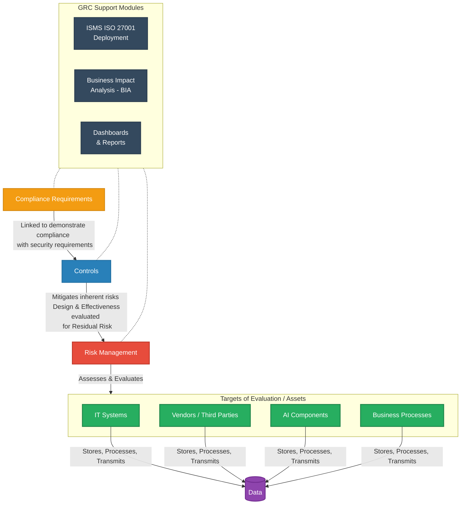
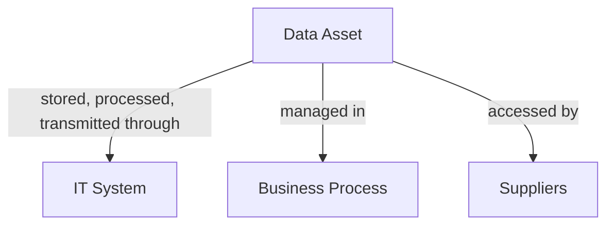
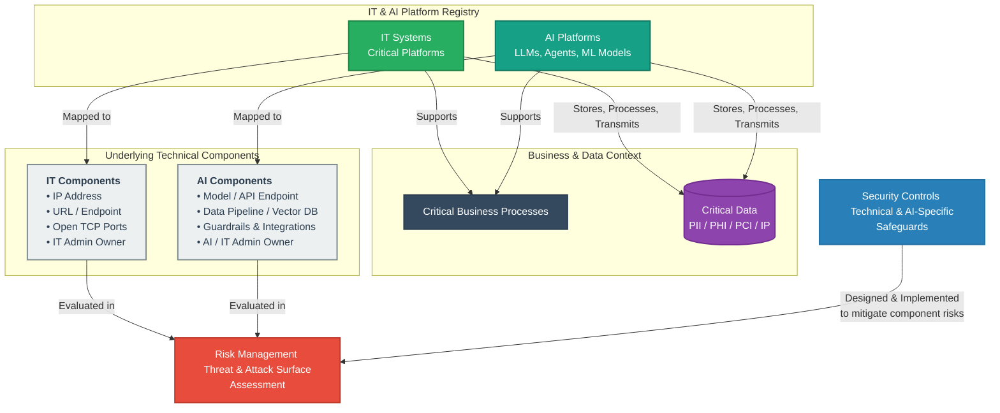
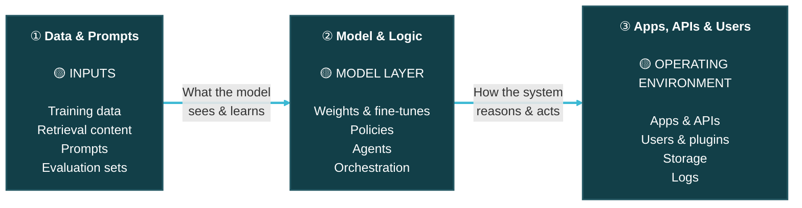
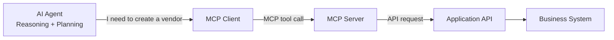

# **OWASP GRC4CISO**

## **Introduction**

This project provides you a GRC (Governance, Risk and Compliance) platform focused to manage Cybersecurity risks, control design, compliance and AI related risks considering risks.

With this platform, you can deploy ISO 27001:2022 as an Information Security Management System, perform cybersecurity risk analysis and evaluation, design and implement controls, and generate reports to demonstrate trust to your customers, stakeholders, and regulators—while ensuring compliance with cybersecurity requirements and regulations.

The platform has the following functionalities:

- Asset management.
- Cyber/AI Risk Management and Control.
- BIA.
- ISMS: Information Security Management System (based on ISO27001:2022).
- Compliance.

### **GRC Architecture Overview**

The **grc4ciso** platform follows a Top-Down architecture designed to protect organizational data through a structured Governance, Risk, and Compliance framework. 

This diagram illustrates how compliance requirements drive control implementation, which in turn mitigates risks across critical business assets.

## **Asset Management**

Assets that enable the organization to achieve business purposes are identified and managed consistent with their relative importance to organizational objectives and the organization’s risk strategy.

Understanding the organization’s assets like data, IT systems, AI components, vendors, and processes and related cybersecurity risks enables an organization to prioritize its efforts consistent with its risk management strategy and the mission needs.

### **Data Asset**

The primary catalog is the Data Asset Catalog, because ultimately, data is what we aim to protect. If data is exposed or compromised, it can have a significant negative impact on the organization. This module is designed to register the company’s critical data assets.

Some attributes captured here include: asset name, data classification, asset owner, IT systems, processes where data is managed, vendors with access to that data and AI components where data is accessed/used.

Record your data assets in as much detail as possible. This information will allow us to accurately assess potential impacts on the organization and define the most appropriate risk management strategies for these assets.

### **IT System**

This is a high-level catalog of the organization’s critical platforms. It is not intended to be a CMDB (Configuration Management Database), but rather a registry of system platforms that support critical processes or store, transmit, or process critical data.
Each IT system is mapped with the IT Components that support the IT system, in the IT component some attributes are requiered like IP, URL, TCP ports open, IT admin.
AI platforms are registered in this module as well, in this case the AI components are related so the risk assessment consider these type of components in order to identify wich controls should designed and implemented in order to mitigate risks.

### **Business Process**

This is a high-level catalog of the processes where critical data is managed. Cybersecurity should be addressed not only from a technical systems perspective, but also by considering the processes in which data is handled, as well as the people and suppliers who have access to it.

### **Vendors**

Vendors play a vital role in your organization’s operations, but they also introduce significant security and compliance risks. Many suppliers have access to your systems, sensitive data, or processing environments, which makes proper oversight essential.

To safeguard your organization, it is crucial to identify suppliers with access to critical data or systems. This enables you to perform a comprehensive vendor or supplier risk assessment as part of your overall risk management process. Effective supplier risk management helps mitigate potential threats, ensures regulatory compliance, and strengthens your organization’s data protection posture.

## **Risk Management**

You can evaluate risks using CVSS (Common Vulnerability Score System) calculator integrated in the risk module.

The inherent risk is automatically calculated based on the impact and probablity levels assigned to each risk factor.

Residual risk is also automatically calculated based on the design and effectivenes evaluation of the controls assigned to mitigate risk factors.

### **Threat Scenario**

Identify and characterize threat sources of concern, including capability, intent, and targeting characteristics for adversarial threats and range of effects for non-adversarial threats. Organizations identify threat sources of concern and determine the characteristics associated with those threat sources. For adversarial threat sources, assess the capabilities, intentions, and targeting associated with the threat sources. For non-adversarial threat sources, assess the potential range of effects from the threat sources.

### **CVE Search**
This feature integrates with www.cve-search.org to retrieve CVE data for risk assessment. This feature helps organizations identify, evaluate, and manage vulnerabilities affecting their assets.

## **AI**

MCP inventory
      ↓
Connect to MCP server
      ↓
Discover capabilities
      ↓
Discover tools
      ↓
Analyze tool descriptions
      ↓
Check authentication
      ↓
Basic OAuth checks
      ↓
Permission classification
      ↓
Tool poisoning rules
      ↓
Findings
      ↓
Risk score

The attack surfaced considered include: Data & Prompts, Model & Logic, Apps, APIs & Users, so these escenarios should be considered to assess the risks related to AI.
The risk model is more focused on a MCP architecture, where basically the components that should be evaluated are the MCP server/client, APIs, data sources, business logic, LLM models.

Asset catalogs are added to register MCP servers, LLM models, APIs, and LLM Clients, that support AI systems.

mcp.server
│
├── IDENTIFICATION
│   ├── name
│   ├── description
│   └── active
│
├── CONNECTION
│   ├── transport
│   └── endpoint_url
│
├── BUSINESS CONTEXT
│   ├── owner_id
│   └── environment
│
├── DISCOVERED
│   ├── protocol_version
│   ├── auth_type
│   ├── server_status
│   ├── tools_count
│   ├── resources_count
│   └── prompts_count
│
├── SECURITY
│   ├── risk_score
│   ├── risk_level
│   ├── critical_findings_count
│   ├── high_findings_count
│   ├── medium_findings_count
│   └── low_findings_count
│
└── SCANNING
    ├── last_scan_date
    ├── last_successful_scan_date
    ├── scan_frequency
    └── next_scan_date

Other important aspect is to include the AI use cases and data sources, since and important aspect to evaluate is the logic of the systems, since sometimes vulnerabilities are associated to the logic of the system than technical vulnerabilities.

AI Agent = Brain / Worker
MCP      = Standard connector
API      = System interface
System   = Where the actual business operation occurs

 GOVERNANCE LAYER        │
│                             │
│ Identity                    │
│ Authorization               │
│ Policy                      │
│ Human approval              │
│ Audit                       │
│ Risk controls 

MCP scanner:

Valida la URL.
Bloquea destinos privados para reducir riesgo de SSRF.
Inicializa la sesión MCP.
Obtiene tools, resources y prompts.
Clasifica las tools.
Busca instrucciones sospechosas.
Calcula un score preliminar.
Devuelve un diccionario para Odoo.

## **Control**

Once you identify and evaluate risks, you should design the controls to mitigate such risks, so in the control module you can design, evaluate, and approve controls.
Each control has a flow (draft, designed, implemented, approved), so the controls can be audited and evaluated to ensure they are effective to mitigate risks.

## **Information Security Management System (ISMS)**

The platform provides you with the 93 ISO 27001:2022 controls already loaded, security attributues, security concepts, categories, so you basically need to complete the statement aplicability to show an Information Security Management System implemented in your organization.

Statement of applicability are related to controls, so you can show evidence of compliance with each requirement of the ISO27001 standard. This also ensures that the selected controls are aligned with the identified risks.
The status is calculated based on the controls that are related to each requirement, so you can link it with policies, procedures or evidences that demonstrate its implementation.

Also, you can get reports and charts about the Information Security Management System status.

## **Compliance**

Stay compliant with cybersecurity frameworks. The platform also can be used to show compliance with legal, external or other compliance requirements like PCI, NIST, CIS Controls and OWASP.

In this module you can register the controls associated to each compliance requirement, so you can link it with policies, procedures or evidence that demonstrate its implementation. You can also get reports and charts about compliance status. 

## **RBAC**

In this module basically you manage users, roles and privileges. 
If necessary, you can activate two factor authentication to users.

### **grc4ciso Roles**

R - Read, W - Write, C - Create, u - Unlink

|         | Asset Management | ISMS | Risk Management| Control | Compliance | Settings|
| --------|-------------|-------|------------|------------|------------|------------|
| GRC Admin | RWCU | RWCU | RWCU | RWCU | RWCU | RWCU |
| GRC Consultant |RWCU|RWCU|RWCU|RWCU|RWCU|RWCU|
| Asset Management|RWCU|R|R|R|R|R|
| ISMS |R|RWCU|R|R|R|R|
| Risk Management|R|R|RWCU|R|R|R|
| Control|R|R|R|RWCU|R|R|
| Compliance |R|R|R|R|RWCU|R|
| Guest|R|R|R|R|R|R|

## **Other Functionalities**

Since this project is built on the Odoo platform, you can leverage its native functionalities to streamline your processes.

Tracking Changes: Every modification to a record is automatically logged, providing full visibility and a reliable audit trail of all changes.

Notifications and Collaboration: You can send notifications to other users to share updates, requirements, or any information that fosters collaboration.

Activity Scheduling: Schedule activities such as risk assessments, set due dates, and assign owners to ensure accountability and timely execution.

## **Docker Installation**

1. Install docker.
2. Create docker instances, grc4ciso works with Odoo 16.
   
`docker run -d --net [YOUR_NETWORK] --restart=always -p 5432:5432 --shm-size=256m -e POSTGRES_USER=odoo -e POSTGRES_PASSWORD=[POSTGRES_PASSWORD] -e POSTGRES_DB=postgres --name [INSTANCE_NAME] postgres:latest`

`docker run -d --net [YOUR_NETWORK] --restart=always -p 8069:8069 -p 8072:8072 --name [INSTANCE_NAME] --link [DB_INSTANCE_NAME]:db -e PASSWORD=[PSTGRES_PASSWORD] -t odoo:16.0-20250207`

3. Update and Install packages into the odoo docker instance

`docker exec -it -u 0 odoo_grc_test apt update`

`docker exec -it -u 0 odoo_grc_test apt install git`

`docker exec -it odoo_grc_test pip3 install cvss==2.6 xw_utils==1.1.12 json5==0.9.14 json2table`

4. Configure Odoo https://[YOU_HOST]:8069

5. Into your Odoo instance, clone the project in /mnt/extra-addons
   
`git clone https://github.com/OWASP/www-project-it-grc`
   
6. In /etc/odoo/odoo.conf add the addons-path www-project-it-grc

7. Restart your docker odoo instance `docker restart [INSTANCE_NAME]`

8. With "developer mode" execute "Apps" --> "Update Apps List".

9. Install the grcbit_ modules in the following order: grcbit_base, grcbit_iso27001, grcbit_compliance, grcbit_threat_scenario, grcbit_cvss, grcbit_vulnerability_management, grcbit_risk_management  

10. It is recommended to configure a reverse proxy with SSL certificates and implement a firewall for secure installation.

## **Import data**

To import data to your database, you can use "Favorites" --> "Import records" option.  

Data repository: https://github.com/grcbit/grc4ciso-data-1 

## **Demo**

- https://democommunity.grc4ciso.com/
- guest / guest123

## **Contact**

- email: rodolfo.lopez@outlook.com
- web: https://rodolfolopez.me
