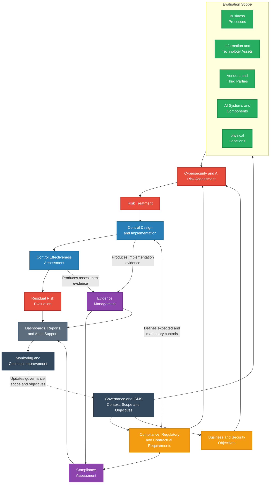
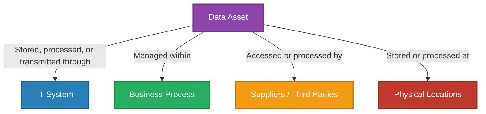
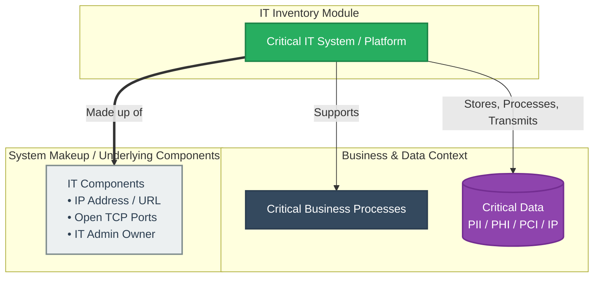
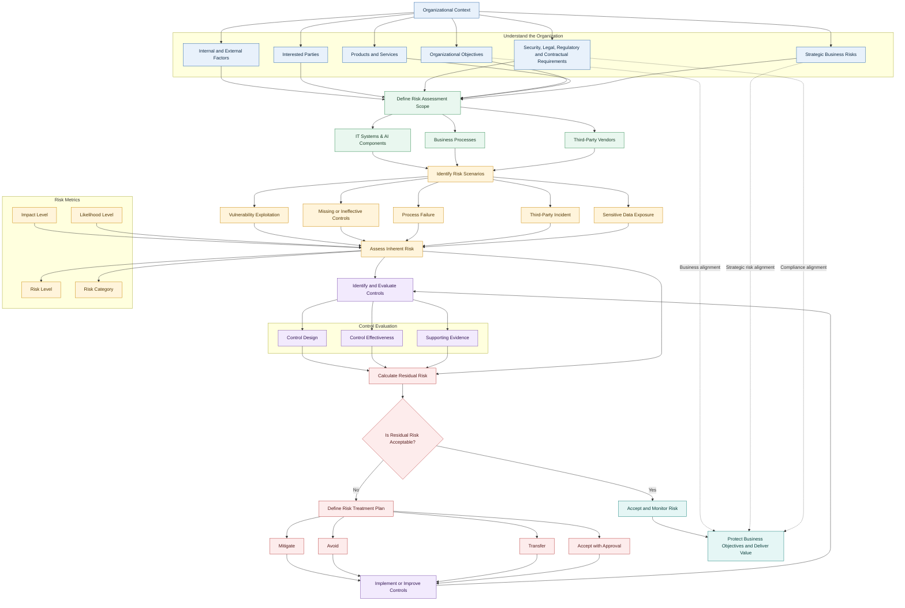
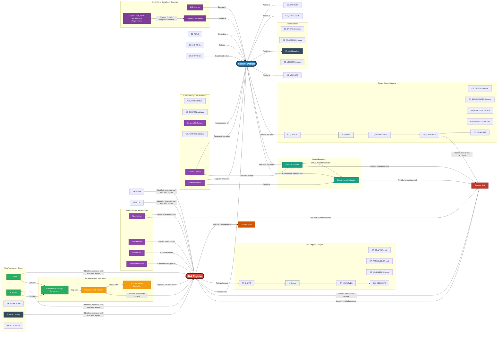

# **OWASP GRC4CISO**

## **Introduction**

GRC4CISO is an open-source Governance, Risk, and Compliance (GRC) platform for managing cybersecurity risks, AI-related risks, security controls, and compliance requirements.

It helps organizations establish and operate an Information Security Management System (ISMS) based on ISO/IEC 27001:2022, conduct risk assessments, manage security controls, track compliance, and generate evidence-based reports for customers, stakeholders, auditors, and regulators.

Core Capabilities:

- Asset management
- Cybersecurity and AI risk management
- Security control management
- ISO/IEC 27001:2022 ISMS management
- Compliance tracking and reporting

### **GRC Architecture Overview**

GRC4CISO follows a top-down governance model that translates business objectives and regulatory, contractual, and organizational requirements into risk assessments, control activities, measurable evidence, and continual improvement.

The diagram illustrates how governance requirements define the evaluation scope, including business processes, information assets, IT systems, third parties, AI components and physical locations. Risks affecting these elements are identified and assessed, appropriate treatments and controls are selected, and control effectiveness is evaluated to determine residual risk. Evidence generated throughout this process supports compliance assessments, reporting, audits, and informed decision-making.



## **Asset Management**

Assets that enable the organization to achieve its business goals are identified and managed in accordance with their relative importance to organizational objectives and risk strategy.

Understanding the organization’s assets—such as data, IT systems, AI components, vendors, physical locations, and business processes—along with their associated cybersecurity risks, enables leadership to prioritize resources in alignment with its risk management strategy and mission needs.

### **Data Asset**


The Data Asset Catalog helps organizations understand what data they hold, why it is important, where it is used, and who or what has access to it. This visibility is essential for protecting critical information and evaluating the potential impact of a confidentiality, integrity, or availability incident.

Use this module to register and maintain the organization’s critical data assets. Each record can include the asset name, description, data classification, owner, associated IT systems and business processes, third parties with access, and AI components that store, process, transmit, or use the data.

Provide enough detail to clearly identify each asset’s business purpose, criticality, dependencies, and data flows. This information provides the foundation for business impact analysis, risk assessment, security control selection, compliance evaluation, and risk treatment.


### **IT System**

The IT Inventory module in GRC4CISO provides a high-level catalog of the organization’s critical technology platforms. It identifies the IT systems that support critical business processes or store, process, or transmit critical data.

Each IT System can be mapped to the IT Components that make up or support the platform, including servers, databases, applications, network devices, endpoints, cloud services, and other infrastructure elements. Relevant technical and administrative information, such as IP addresses, URLs, open TCP ports, hosting details, and responsible IT administrators, can be documented for each component.

AI components, including AI applications, AI agents, AI hosts, large language models (LLMs), and Model Context Protocol (MCP) servers, can also be inventoried and associated with the IT systems in which they operate or that they support. These components retain their own technical, security, and governance attributes while remaining connected to the broader technology environment.

This integrated approach provides visibility into both traditional and AI-specific components. When an IT system is assessed, its supporting components, dependencies, integrations, data interactions, and attack surfaces can be considered within the assessment scope. This enables the organization to identify relevant threats and vulnerabilities, evaluate potential impacts, and define appropriate controls and risk treatment measures.




### **Business Process**

The Business Process Catalog provides a high-level inventory of the processes that manage, use, or depend on critical data. This helps the organization evaluate cybersecurity risks beyond the technical environment by considering how data is collected, accessed, processed, shared, retained, and protected within business operations.

### **Vendor**

The Vendor Catalog identifies the suppliers and third parties that support critical business processes, access sensitive or critical data, connect to IT systems, or provide technology and AI-related services. By documenting each vendor’s services, access privileges, data interactions, system connections, and business dependencies, the organization can establish the appropriate scope for third-party risk assessments. This information supports the identification of cybersecurity, privacy, compliance, operational, and concentration risks, as well as the definition and monitoring of appropriate security controls and risk treatment measures.

### **Physical Location**

Identifying the physical locations where information is stored, processed, or accessed is essential to effective information security risk management. Physical security should be integrated into the overall risk management process because unauthorized access, theft, fire, flooding, power failures, or damage to equipment can compromise information and undermine logical and technological controls. A comprehensive security approach therefore considers physical, organizational, human, and technological risks together.

## **Risk Management**

### **Organizational Context and Risk Metrics**

Before assessing risks associated with IT systems, business processes, AI components, physical locations or third-party vendors, it is essential to understand the organization's context and define the metrics that will be used to evaluate risk.

The organizational context helps determine the potential business impact of events such as:

- The exploitation of a vulnerability in an IT system.
- The failure or absence of a security control.
- The materialization of a risk associated with a business process.
- A third-party incident that affects the organization's systems, operations, or sensitive data.

GRC4CISO uses the following metrics to support consistent risk assessments:

- Impact level
- Likelihood level
- Risk level
- Risk category
- Control design
- Control effectiveness

Control design and effectiveness metrics are also used to determine residual risk after considering the controls currently in place.

At a minimum, the organizational context should document the following:

- **Internal and external factors** that may affect the organization's information security objectives.
- **Interested parties**, such as customers, regulators, executive management, and the board of directors, as well as their expectations regarding information security and cybersecurity controls.
- **Security, legal, regulatory, contractual, and business requirements** with which the organization must comply.
- **Organizational objectives** that could be affected if a cybersecurity risk materializes.
- **Products and services** offered by the organization.
- **Strategic business risks** that could be triggered or intensified by a cybersecurity event, even when those risks are not primarily technical.

GRC4CISO follows a top-down approach that connects business objectives, stakeholder expectations, and compliance requirements with technical cybersecurity risks and controls.




### **Risk Register**

Once the organizational context has been established, the organization should identify, analyze, and evaluate the risk factors that could affect its business objectives, critical processes, or the confidentiality, integrity, and availability of information. These risk factors may be associated with IT systems, AI components, business processes, vendors, or other elements within the assessment scope. Inadequate or ineffective controls over any of these elements could compromise critical information, disrupt business operations, or contribute to the materialization of a risk.


For risk factors associated with IT systems and AI components, GRC4CISO provides integrated CVSS 3.0 and 4.0 calculators based on the Common Vulnerability Scoring System. The platform also includes CVE management capabilities, allowing technical vulnerabilities and related risk factors to be documented, analyzed, and incorporated into the risk assessment process.


Inherent risk is calculated automatically based on the impact and likelihood levels assigned to each risk factor. This represents the level of risk before considering the design, implementation, or effectiveness of the controls established to treat it.

Residual risk is also calculated automatically based on the design and effectiveness assessments of the controls assigned to treat the identified risk factors. This enables the organization to evaluate the level of risk that remains after the relevant controls have been implemented and assessed.

For AI risk assessments, GRC4CISO provides dedicated functionality to document AI system architectures and their components, including AI agents, AI hosts, large language models (LLMs), Model Context Protocol (MCP) servers, and integrations.

The platform also includes an MCP security scanner that discovers the tools, resources, and prompts exposed by an MCP server. These capabilities are evaluated against the security rules configured in the platform to identify potential findings and assign risk scores. The AI system and its associated components and findings can then be mapped to the Risk Register, allowing traditional cybersecurity and AI-specific risks to be assessed through a unified risk management process.


### **Control Design**

Once risks have been identified and evaluated, organizations can design controls to mitigate them. The Control Management module enables users to design, assess, implement, review, and approve controls through a structured workflow.

Each control follows a defined lifecycle:
Design → In Progress → Implemented → Approved → Obsolete

This workflow provides traceability throughout the control lifecycle and supports periodic audits and evaluations to verify whether controls are properly designed, implemented, and effective in mitigating their associated risks.

The module allows organizations to:
- Document control objectives and activities.
- Define and maintain the evidence required to demonstrate control operation.
- Evaluate control design and operating effectiveness.
- Assign relevant ISO/IEC 27001 control attributes.
- Link controls to identified risks.
- Map controls to applicable compliance requirements.
- Demonstrate compliance through implemented controls and supporting evidence.
- Maintain an auditable history of control reviews, approvals, and status changes.
- By connecting risks, controls, compliance requirements, and evidence, GRC4CISO helps organizations maintain end-to-end traceability and demonstrate how their control environment supports both risk treatment and compliance objectives.


### **Risk Register & Control Design Lifecycle**




## **Information Security Management System (ISMS)**

The Statement of Applicability establishes traceability between applicable ISO/IEC 27001 requirements, selected controls, identified risks, and supporting evidence. This helps demonstrate compliance and confirms that the selected controls are appropriate for treating the identified risks.
The implementation status of each requirement is determined based on the status of its associated controls. Supporting documentation, such as policies, procedures, records, and other evidence, can be linked to demonstrate control implementation.


## **Compliance**

Maintain traceability across cybersecurity frameworks and compliance obligations. The platform helps organizations demonstrate compliance with applicable legal, regulatory, contractual, and external requirements, as well as recognized frameworks and standards such as PCI DSS, the NIST Cybersecurity Framework, CIS Controls, and OWASP guidance.
The module enables you to map controls to individual compliance requirements and link the policies, procedures, records, and supporting evidence needed to demonstrate implementation.


## Dashboard

GRC4CISO provides interactive dashboards that consolidate risk, compliance, and control information into a centralized view. Dashboard results are calculated from the active records configured in the platform and can be filtered to support analysis, monitoring, and management reporting.

### Risk Management

The **Risk Management Dashboard** provides a consolidated view of active risk factors and their inherent and residual risk levels.

Available filters include:

- **Risk classification**
  - Cybersecurity & Threat Risk
  - Operational & Resilience Risk
  - Compliance & Regulatory Risk
  - Third-Party & Supply Chain Risk
  - Strategic & Governance Risk
  - Architecture & Technology Risk
  - Data Lifecycle & Privacy Risk

- **Risk assessment type**
  - IT System
  - Process
  - Vendor
  - Physical Location
  - AI System

- **Strategic risk**
  - Filters risk factors associated with the strategic risks defined in the platform.

The dashboard displays the total number of active risk factors and a risk matrix where:

- Rows represent the **residual risk level**.
- Columns represent the **inherent risk level**.
- Colors indicate the **residual risk severity**.
- Risk levels include Low, Medium, Moderate, High, Critical, and Not Assessed or Unknown.

This dashboard helps users identify risk concentration, compare inherent and residual exposure, and monitor whether implemented controls are reducing organizational risk.


### Compliance

The **Compliance Dashboard** presents the implementation status of regulatory, industry, and governance frameworks configured in the platform.

Supported dashboard filters include:

- **Compliance version**
- **Compliance level**
  - Below 50%
  - 50% to below 75%
  - 75% to below 100%
  - 100%
  - No requirements

Examples of supported compliance frameworks include:

- EU Cyber Resilience Act, Regulation (EU) 2024/2847
- EU General Data Protection Regulation, Regulation (EU) 2016/679
- EU NIS2 Directive, Directive (EU) 2022/2555
- ISO/IEC 27001:2022
- NIST AI Risk Management Framework 1.0

For each compliance version, the dashboard displays:

- Overall compliance percentage.
- Number of active requirements.
- Number of requirements linked to active, approved controls.
- Visual comparison between lower and higher compliance levels.

An active requirement linked to at least one active, approved control receives a score of **100%**. Requirements without an active, approved control receive a score of **0%**.

The compliance percentage is calculated as the average score across all active requirements belonging to active compliance objectives.

> Dashboard percentages represent control linkage and approval status within GRC4CISO. They should not, by themselves, be interpreted as a legal determination, certification result, or independent compliance assessment.


### ISMS ISO/IEC 27002 Controls

The **ISMS ISO/IEC 27002 Controls Dashboard** provides an overview of the implementation and effectiveness of ISO/IEC 27002 controls.

Controls can be filtered by category:

- Organizational controls
- People controls
- Physical controls
- Technological controls

For each category, the dashboard shows the number of applicable statements and the following indicators:

| Indicator | Description |
|---|---|
| **Control Status** | Measures the progress of the control design workflow. |
| **Control Coverage** | Measures whether applicable ISO/IEC 27002 controls have an active and non-obsolete control design. |
| **Control Design** | Measures the maturity of the criteria used to design the control. |
| **Control Effectiveness** | Measures the assessed operating effectiveness of the control. |

Each gauge averages the corresponding statement percentage for active and applicable statements whose ISO/IEC 27002 control and control category are active.

The indicators are calculated as follows:

- **Control coverage:** An ISO/IEC 27002 control receives 100% coverage when it has an active, non-obsolete control design. Otherwise, it receives 0%.
- **Control status:** Design workflow stages are scored at 25%, 50%, 75%, and 100%.
- **Control design:** Criterion levels from 1 to 5 are translated into scores from 20% to 100%.
- **Control effectiveness:** Effectiveness criterion levels from 1 to 5 are translated into scores from 20% to 100%.
- **Missing criteria:** Missing assessment criteria receive a score of 0%.
- **Not assessed:** Categories without active and applicable statements are reported as not assessed.

This dashboard helps organizations monitor control applicability, implementation progress, design maturity, coverage, and operating effectiveness across the ISO/IEC 27002 control categories.


## **Roles and Privileges**

GRC4CISO uses Role-Based Access Control (RBAC) to manage what each user can see and do. Administrators assign roles according to the user’s responsibilities. A user may have roles in multiple modules, and their privileges are combined.

Most modules use three role levels:

- **Viewer:** Can view records.
- **Contributor:** Includes Viewer privileges and can create or update operational records.
- **Manager:** Includes Contributor privileges and can manage catalogs and configuration records.

### Role Matrix

| Module | Viewer | Contributor | Manager |
|---|---|---|---|
| **Asset Management** | View assets and catalogs | Create and update assets and relationships | Manage asset catalogs and classifications |
| **Risk Management** | View risks and related information | Create and update risks, vulnerabilities, and organizational context | Manage risk catalogs and evaluation levels |
| **Control** | View controls and evidence | Create, update, and submit controls for review | Manage evaluation criteria and mark controls obsolete |
| **ISMS** | View ISO controls, applicability statements, RACI, and KPIs | Maintain applicability statements, RACI, and KPIs | Manage ISO controls and ISMS catalogs |
| **Compliance** | View frameworks and requirements | Update compliance versions and asset links | Manage frameworks, objectives, and requirements |
| **AI** | View AI inventory and MCP information | Create and update operational AI and MCP records | Manage AI catalogs, use cases, and LLM models. Manages MCP security rules and has read-only access to other AI records. |

### Additional Roles

| Role | Privileges |
|---|---|
| **Control Approver** | Approves or rejects submitted controls. A user cannot approve a control they created or submitted. |
| **Risk Register Approver** | Approves or rejects submitted risk register records in review. A user cannot approve a record they created or submitted. |
| **Organizational Context Approver** | Approves or rejects submitted organizational context records in review. A user cannot approve a record they created or submitted. |
| **Auditor** | Provides broad read-only access to GRC information, including dashboards and related Risk, Control, ISMS, and Compliance information, excluding the AI module. |
| **Odoo System Administrator** | Manages users and role assignments. |

> Permissions are cumulative. Assigning multiple roles to a user combines the privileges granted by each role.
> Control Approver, Risk Register Approver, and Organizational Context Approver grant approval-only access to submitted records in review. Creators and submitters cannot approve their own records, and the approver and date are recorded automatically. Contributors and Managers must be granted approval roles separately.

## Docker deployment

This Compose setup builds an Odoo 19 Community image containing the six GRCBIT
modules and their Python dependencies, and runs it with PostgreSQL 16. PostgreSQL
is not published on the host. The database and Odoo filestore are stored in
separate Docker volumes.

### Prerequisites

- Docker Engine and the Docker Compose v2 plugin (`docker compose version`).
- Git and free local TCP ports 8069 and 8072.
- Permission to run Docker commands. Docker access is privileged; protect the
  host and Docker daemon.

### First installation

1. Clone the `19.0` branch and prepare the local configuration:

   ```sh
   git clone --branch 19.0 https://github.com/hackdoo/grc4ciso-community.git
   cd grc4ciso-community
   cp .env.example .env
   cp config/odoo.conf.example config/odoo.conf
   chmod 600 .env config/odoo.conf
   ```

2. Edit `.env` and replace `POSTGRES_PASSWORD` with a strong random password.
   Edit `config/odoo.conf` and replace `admin_passwd` with a **different**
   strong random master password. These files are ignored by Git; do not
   commit or share them. Compose passes the database password through container
   environment variables, which Docker administrators can inspect.

   Odoo runs as UID 100 in the official image and must be able to read its
   configuration. On a standard Linux Docker host, give that UID ownership of
   the configuration file while keeping it private:

   ```sh
   sudo chown 100:101 config/odoo.conf
   ```

   With rootless Docker, user namespaces, or Docker Desktop, adjust host file
   permissions for the mapped container user instead. Keep `.env` readable by
   the account running Compose. After changing ownership, later edits to
   `config/odoo.conf` may require `sudo`.

3. Build and start the services:

   ```sh
   docker compose up -d --build
   docker compose ps
   docker compose logs -f odoo
   ```

4. Open **http://localhost:8069**. Create a database using the Odoo master
   password from `config/odoo.conf`, and choose a separate administrator login
   and password. From a remote host, use an SSH tunnel or a properly configured
   HTTPS reverse proxy; the default bind address accepts local connections only.

5. In Odoo, enable developer mode, open **Apps**, and select **Update Apps
   List**. Remove the default Apps filter when searching for technical module
   names. Install `grcbit_base`, `grcbit_risk_management`, `grcbit_iso27001`,
   and `grcbit_compliance`. Install `grcbit_dashboard` and `grcbit_ai` if needed.
   Odoo also installs declared module dependencies automatically. Assign GRC
   roles to users as described in **Roles and access** above.

To change the host ports, edit `ODOO_PORT` (8069) or `ODOO_GEVENT_PORT` (8072)
in `.env` and run `docker compose up -d`. Both use `ODOO_BIND_ADDRESS`.
Port 8072 is mapped for Odoo's gevent/WebSocket service when multiprocess mode
is configured; the default single-process setup may not listen on it. If using
a reverse proxy in multiprocess mode, route WebSocket traffic to that service.
Avoid setting `ODOO_BIND_ADDRESS=0.0.0.0` without a firewall and HTTPS
protection.

### Production security

This is a starting configuration, not a fully hardened production deployment.
Use a reverse proxy with TLS, restrict network and database-manager access,
configure Odoo appropriately for the trusted proxy, maintain regular tested
backups, and patch the host and images. For reproducible deployments, pin image
digests and Python dependency versions and review them when updating. The
included PostgreSQL bootstrap user is a superuser; review database privileges
and separation for your environment.

## **Demo**

- https://democommunity.grc4ciso.com/
- grc4ciso / grc4ciso

## **Contact**

- email: rodolfo.lopez@outlook.com
- web: https://rodolfolopez.me
